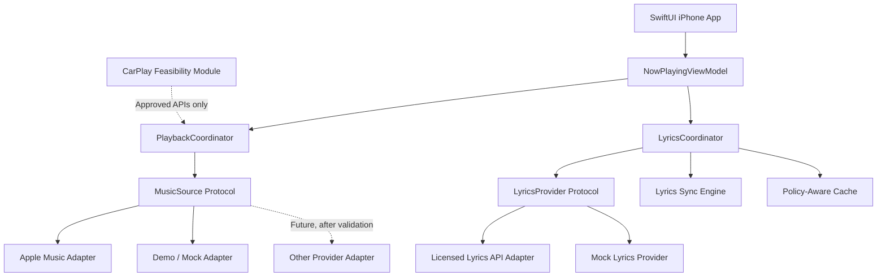

# Lyrics CarPlay

> An iOS companion app for discovering, synchronizing, and displaying song lyrics, with an exploration of Apple CarPlay-compatible experiences.

**Status:** Planning / Proof of Concept  
**Platform:** iOS (primary); CarPlay (subject to Apple's supported categories, templates, and entitlement approval)  
**Language:** Swift  
**UI:** SwiftUI

## 1. Vision

Lyrics CarPlay aims to make it easier to follow lyrics for the music you're listening to. The initial product is a polished iPhone experience that identifies the currently playing track, retrieves licensed lyrics where available, synchronizes timed lines, and presents them clearly. The longer-term goal is to explore an Apple-approved CarPlay companion experience **without distracting drivers**.

**Important feasibility boundary:** Apple's public CarPlay APIs use restricted app categories and prescribed templates. A custom full-screen, scrolling-lyrics CarPlay interface is **not** an assumed supported feature. Do not build the project around obtaining a CarPlay entitlement or bypassing template restrictions. Prioritize iPhone lyrics, passenger-safe experiences, and approved audio-app interactions; validate CarPlay eligibility directly with Apple before implementing any CarPlay-specific UI. The project must not encourage drivers to read lyrics while driving.

## 2. Goals and non-goals

### Goals
- Build a native, responsive iOS application.
- Identify the current song from supported, authorized playback sources.
- Retrieve lyrics through providers that explicitly permit the intended use.
- Support both plain and time-synchronized lyrics when licensed data is available.
- Provide a smooth line-highlighting and scrolling experience on iPhone.
- Cache permitted metadata and lyrics securely and respect provider retention policies.
- Implement robust loading, unavailable, offline, and authorization states.
- Research an Apple-compliant CarPlay experience and document the result.

### Non-goals for MVP
- Showing arbitrary custom lyrics UI on the CarPlay head unit.
- Reading or scraping another app's private playback data.
- Scraping lyrics from websites or redistributing unlicensed lyrics.
- Circumventing Apple entitlements, driver-distraction protections, or app review.
- Guaranteeing support for Spotify or Apple Music playback before API capabilities are validated.

## 3. MVP scope

| Feature | Priority | Definition of done |
|---|---|---|
| App shell and navigation | P0 | Launches on supported iOS devices; clear home, now-playing, and settings screens |
| Music authorization | P0 | Requests only required permissions; handles denial and revocation |
| Now-playing metadata | P0 | Displays title, artist, album, artwork, and source when available |
| Lyrics provider adapter | P0 | Fetches a permitted lyric response and normalizes it into app models |
| Static lyrics view | P0 | Renders available lyrics; handles no-match and no-lyrics states |
| Timed lyrics sync | P1 | Highlights the active line using a validated playback position |
| Auto-scroll and manual override | P1 | Smoothly follows playback; pauses auto-scroll after user interaction |
| Local caching | P1 | Obeys lyric provider licensing and cache rules |
| Accessibility | P1 | Dynamic Type, VoiceOver labels, contrast, reduced motion |
| CarPlay feasibility spike | P0 research | Written decision on category, entitlement, templates, and permitted functionality |
| CarPlay implementation | Conditional | Only after confirming eligibility and a driver-safe approved design |

## 4. Technology stack

| Layer | Choice | Rationale |
|---|---|---|
| Language | Swift | Native iOS development |
| Interface | SwiftUI | Declarative, testable UI |
| Music integration | MusicKit / system media APIs where authorized | Apple Music catalog, permissions, and eligible playback features |
| CarPlay | CarPlay framework, conditional | Only for approved app categories and templates |
| Concurrency | Swift async/await | Structured asynchronous networking |
| Networking | URLSession | Native HTTP networking |
| Persistence | SwiftData or lightweight local storage | Preferences and licensed cache metadata |
| Architecture | MVVM + protocol-based services | Separation of UI, playback, and lyrics sources |
| Dependency management | Swift Package Manager | Native package support |
| Testing | XCTest / Swift Testing | Unit and integration testing |
| CI | GitHub Actions + macOS runner | Build, test, and lint automation |
| Optional backend | FastAPI + PostgreSQL | Only if provider secrets, account features, or usage limits require a server |

**Provider caveats:** MusicKit is not a general-purpose interface for reading every other music app's playback state. Spotify playback integrations require a separate capability and policy review. Lyrics licensing is independent of music playback access: access to a track does not automatically grant permission to display or redistribute its lyrics.

## 5. Proposed architecture



### Core responsibilities

**PlaybackCoordinator:** Maintains the normalized track identity, playback state, current position, and source capabilities. Must not claim precise synchronization if the source does not provide reliable position updates.

**LyricsCoordinator:** Matches tracks to lyrics, handles provider errors and licensing constraints, and exposes plain or timed lines to the view model.

**LyricsSyncEngine:** Uses time stamps to select the active lyric line. Handles seeking, pausing, track changes, clock drift, and absent timing data.

**Provider adapters:** Encapsulate vendor-specific authentication, rate limits, track IDs, responses, and error handling behind stable interfaces.

## 6. Repository structure

```text
lyrics-carplay/
├── README.md
├── LICENSE
├── .gitignore
├── .github/
│   ├── workflows/
│   │   ├── ios-ci.yml
│   │   └── pr-checks.yml
│   ├── ISSUE_TEMPLATE/
│   └── pull_request_template.md
├── docs/
│   ├── architecture.md
│   ├── api-integrations.md
│   ├── lyrics-licensing.md
│   ├── carplay-feasibility.md
│   ├── privacy-security.md
│   └── testing.md
├── LyricsCarPlay.xcodeproj/
├── LyricsCarPlay/
│   ├── App/
│   │   └── LyricsCarPlayApp.swift
│   ├── Models/
│   │   ├── Track.swift
│   │   ├── LyricLine.swift
│   │   └── PlaybackState.swift
│   ├── Views/
│   │   ├── HomeView.swift
│   │   ├── NowPlayingView.swift
│   │   ├── LyricsView.swift
│   │   └── SettingsView.swift
│   ├── ViewModels/
│   │   └── NowPlayingViewModel.swift
│   ├── Services/
│   │   ├── Playback/
│   │   │   ├── MusicSource.swift
│   │   │   ├── AppleMusicSource.swift
│   │   │   └── MockMusicSource.swift
│   │   ├── Lyrics/
│   │   │   ├── LyricsProvider.swift
│   │   │   ├── LicensedLyricsProvider.swift
│   │   │   └── MockLyricsProvider.swift
│   │   ├── LyricsSyncEngine.swift
│   │   └── LyricsCache.swift
│   ├── CarPlay/
│   │   └── README.md
│   ├── Resources/
│   └── Utilities/
├── LyricsCarPlayTests/
│   ├── LyricsSyncEngineTests.swift
│   ├── TrackMatchingTests.swift
│   └── ProviderAdapterTests.swift
└── LyricsCarPlayUITests/
```

This is a **target structure**, not a claim that all listed files already exist.

## 7. Detailed development roadmap

### Phase 0 — Feasibility, policies, and product definition
**Estimated duration:** 1 week  
**Milestone:** `M0 — Feasibility decision`

- [ ] Review Apple's current CarPlay app-category and entitlement requirements.
- [ ] Determine whether any proposed feature can be implemented using approved CarPlay templates.
- [ ] Record prohibited or unsupported concepts in `docs/carplay-feasibility.md`.
- [ ] Confirm which music sources expose authorized metadata and accurate playback timing.
- [ ] Compare lyrics providers by licensing, synchronized lyrics availability, pricing, attribution, and cache restrictions.
- [ ] Choose the minimum supported iOS version and physical test devices.
- [ ] Define driver-safety and passenger-use constraints.
- [ ] Choose an MVP provider and prepare mock data as a fallback.

**Exit criteria:** A written, evidence-backed go/no-go decision for CarPlay; a viable iPhone-only MVP independent of that decision.

### Phase 1 — Project bootstrap and UI prototype
**Estimated duration:** 1 week  
**Milestone:** `M1 — App skeleton`

- [ ] Create an Xcode iOS project using SwiftUI.
- [ ] Set bundle identifier, deployment target, signing, and build configurations.
- [ ] Add app navigation, reusable components, colors, and typography.
- [ ] Build home, now-playing, lyrics, and settings screens with mock data.
- [ ] Introduce `Track`, `LyricLine`, and `PlaybackState` models.
- [ ] Establish MVVM boundaries and dependency injection.
- [ ] Add unit-test and UI-test targets.
- [ ] Configure `.gitignore`, issue templates, and PR checks.

**Exit criteria:** App launches in the iOS simulator and demonstrates the complete mocked user journey.

### Phase 2 — Music source integration
**Estimated duration:** 1–2 weeks  
**Milestone:** `M2 — Live track metadata`

- [ ] Define the `MusicSource` protocol with track, playback state, and position capabilities.
- [ ] Integrate the selected authorized source (Apple Music first, if suitable).
- [ ] Implement permission request, authorization state, and account-error handling.
- [ ] Show current track metadata and artwork when available.
- [ ] Observe playback, pause, resume, seeking, and track changes.
- [ ] Explicitly expose `positionUnavailable` when synchronization cannot be supported.
- [ ] Test simulator limitations and physical-device behavior.

**Exit criteria:** Authorized playback source drives the app UI; failures are visible and recoverable.

### Phase 3 — Lyrics retrieval and matching
**Estimated duration:** 1–2 weeks  
**Milestone:** `M3 — Lyrics loaded`

- [ ] Define a `LyricsProvider` protocol.
- [ ] Integrate a provider with rights for the app's intended lyric display.
- [ ] Match by provider track ID when possible; otherwise normalize title, artist, and duration.
- [ ] Handle remasters, live versions, featured artists, and ambiguous matches.
- [ ] Parse static and timed lyrics into normalized models.
- [ ] Add request cancellation, rate-limit handling, retry rules, and attribution.
- [ ] Store only data allowed by provider policy.
- [ ] Provide explicit states for no lyrics, no network, and low-confidence match.

**Exit criteria:** User can see the correct, authorized lyrics for supported tracks.

### Phase 4 — Time synchronization and UX
**Estimated duration:** 1–2 weeks  
**Milestone:** `M4 — Synchronized lyrics`

- [ ] Implement a deterministic time-to-line lookup.
- [ ] Highlight the active line as playback progresses.
- [ ] Implement auto-scroll with a temporary manual-scroll override.
- [ ] Recalculate active line after seek, pause, resume, and track changes.
- [ ] Handle instrumental gaps and lines with duplicate timestamps.
- [ ] Avoid synthetic precision when timing data is absent.
- [ ] Support larger text, VoiceOver, high contrast, and reduced motion.
- [ ] Validate UI smoothness and battery impact on physical devices.

**Exit criteria:** Timed lyrics stay acceptably aligned under normal playback, pauses, and seeks; static lyrics remain usable.

### Phase 5 — Reliability, privacy, and offline behavior
**Estimated duration:** 1 week  
**Milestone:** `M5 — Beta-ready iPhone app`

- [ ] Cache permitted responses with expiration and attribution rules.
- [ ] Add a clear loading skeleton and empty/error states.
- [ ] Store sensitive credentials only through appropriate secure mechanisms.
- [ ] Keep vendor secrets out of the client binary; use a backend if required.
- [ ] Minimize telemetry and avoid logging personal tokens or lyrics payloads.
- [ ] Add privacy disclosures and user-facing permission explanations.
- [ ] Run unit, UI, and device tests across supported iOS versions.
- [ ] Conduct TestFlight beta testing where eligible.

**Exit criteria:** Stable beta build with documented known limitations and compliant data handling.

### Phase 6 — CarPlay feasibility outcome (conditional)
**Estimated duration:** Depends on Apple's requirements  
**Milestone:** `M6 — Approved CarPlay path or documented no-go`

- [ ] Reconfirm current CarPlay app categories, supported templates, and entitlements.
- [ ] If eligible, request the appropriate entitlement and follow Apple's approval process.
- [ ] Design only approved, low-distraction interactions using supported templates.
- [ ] Test on Apple's CarPlay simulator and, when authorized, compatible hardware.
- [ ] Verify the app never relies on a custom lyrics-scrolling head-unit interface.
- [ ] If ineligible, document the result and keep the product iPhone-first.

**Exit criteria:** An approved, compliant CarPlay feature **or** a clearly documented decision not to ship CarPlay support.

### Phase 7 — Release and maintenance
**Estimated duration:** 1–2 weeks, after validation  
**Milestone:** `v1.0`

- [ ] Finalize app icon, screenshots, onboarding, and store description.
- [ ] Complete licensing and provider attribution requirements.
- [ ] Review Apple App Store policies and privacy disclosures.
- [ ] Verify error recovery, memory usage, battery use, and accessibility.
- [ ] Tag release, publish changelog, and document supported music sources.
- [ ] Establish bug triage, dependency updates, and regression tests.

**Exit criteria:** iPhone app is ready for submission; CarPlay claims reflect only approved, implemented features.

## 8. Timeline overview

| Week | Target | Deliverable |
|---|---|---|
| 1 | Feasibility | Provider and CarPlay decisions |
| 2 | Foundation | Mocked SwiftUI app |
| 3–4 | Playback | Live now-playing metadata |
| 5–6 | Lyrics | Licensed lyric lookup and display |
| 7–8 | Sync | Timed highlighting and auto-scroll |
| 9 | Hardening | Cache, privacy, tests, beta |
| 10+ | Conditional | CarPlay-approved features, release preparation |

These are **planning estimates**, not guaranteed dates. Provider access, licensing, and Apple approvals can materially change the schedule.

## 9. Suggested data models

```swift
struct Track: Identifiable, Equatable {
    let id: String
    let title: String
    let artist: String
    let album: String?
    let duration: TimeInterval?
    let artworkURL: URL?
    let source: String
}

struct LyricLine: Identifiable, Equatable {
    let id: UUID
    let startTime: TimeInterval?
    let text: String
}

enum LyricsState {
    case idle
    case loading
    case available([LyricLine])
    case unavailable(reason: String)
    case failed(message: String)
}
```

For synced lyrics, `startTime` is required on timed lines; for plain lyrics, it may be `nil`. Track identifiers should include provider context to avoid collisions.

## 10. Core synchronization logic

1. Receive a track identity and reliable playback position.
2. Fetch matching lyrics, canceling stale requests when the track changes.
3. Sort timed lines by timestamp, preserving stable ordering for ties.
4. Select the latest line whose start time is not greater than playback time.
5. Update the highlighted line when the index changes.
6. Recompute immediately after seeks or track transitions.
7. Suspend position-based highlighting if timing or playback position is unavailable.

**Example:** At 42.5 seconds, if lines begin at 39.0 and 44.0 seconds, highlight the 39.0-second line.

**Testing cases:** Beginning/end of track, no timestamps, negative or missing position, repeated timestamps, seek backward, paused playback, rapid track switching, slow provider response, and network loss.

## 11. API and licensing checklist

Before committing to a provider, document:

- [ ] Does its API expose lyrics or only song metadata?
- [ ] Are full lyrics and synchronized lyrics licensed for third-party display?
- [ ] Is attribution mandatory?
- [ ] Are caching, offline access, and public distribution permitted?
- [ ] Are rate limits and costs suitable for the expected usage?
- [ ] Does the integration require OAuth or a confidential backend?
- [ ] Can the provider return reliable playback position?
- [ ] Are there territorial or commercial-use restrictions?

Never assume that a free endpoint grants redistribution rights. Do not commit API keys, user tokens, copyrighted lyric datasets, or provider-restricted responses.

## 12. Testing strategy

| Level | Focus |
|---|---|
| Unit | Timestamp lookup, track matching, parsing, cache expiration |
| Integration | Provider adapters, auth state, retries, cancellations |
| UI | Navigation, loading/error states, manual scrolling, accessibility |
| Device | Playback updates, background/foreground transitions, battery |
| CarPlay (conditional) | Entitlement, supported templates, safe interactions, device compatibility |

**Minimum quality gate:** All unit tests pass; no committed secrets; build succeeds; critical flows manually verified on at least one physical iPhone.

## 13. GitHub workflow

1. Create an issue with a clear problem statement and acceptance criteria.
2. Branch from `main` using `feature/<issue>-<description>`, `fix/<issue>-<description>`, or `docs/<description>`.
3. Commit focused changes with descriptive messages.
4. Open a pull request linked to the issue.
5. Run automated checks and request code review.
6. Squash-merge approved changes into protected `main`.
7. Close the issue and update the relevant milestone.

**Recommended branch protections:** Require passing iOS build/tests, prevent force-pushes to `main`, require at least one review for team contributions, and enable secret scanning when available.

### Initial GitHub milestones

- `M0 — Feasibility`
- `M1 — UI Foundation`
- `M2 — Playback Integration`
- `M3 — Lyrics Provider`
- `M4 — Synchronization`
- `M5 — iPhone Beta`
- `M6 — CarPlay Decision`
- `v1.0 — Release`

### Initial issues

- `docs: research CarPlay entitlement and template constraints`
- `docs: evaluate lyrics licensing providers`
- `chore: bootstrap SwiftUI Xcode project`
- `feat: implement Track and LyricLine models`
- `feat: build mocked now-playing screen`
- `feat: define MusicSource protocol`
- `feat: implement authorized Apple Music adapter`
- `feat: define LyricsProvider protocol`
- `feat: build lyrics loading and error states`
- `feat: implement timed lyric highlighting`
- `test: cover seeking and track transitions`
- `ci: add macOS build and test workflow`

## 14. Definition of done

A feature is done when it has clear acceptance criteria, is tested, handles expected errors, respects licensing and privacy requirements, and is documented where necessary. A feature depending on unapproved CarPlay capabilities is **not done** simply because it works in a prototype or simulator.

## 15. Future ideas (not committed scope)

- More authorized music providers.
- User-controlled text sizing, themes, and translations where licensed.
- Improved multilingual lyric matching.
- Optional account sync for preferences.
- Better offline handling where permitted.
- Passenger-oriented second-screen experiences outside unsupported CarPlay UI.
- Approved CarPlay integration only if Apple provides an eligible category and suitable templates.

## 16. Getting started

### Requirements
- A Mac with a compatible version of Xcode.
- A supported iPhone or iOS simulator.
- An Apple Developer account for capabilities and distribution that require it.
- Credentials for any selected authorized music or lyrics APIs.

### Local setup (once the Xcode project is committed)

```bash
git clone https://github.com/<YOUR_USERNAME>/lyrics-carplay.git
cd lyrics-carplay
open LyricsCarPlay.xcodeproj
```

1. Select a simulator or a provisioned iPhone in Xcode.
2. Configure your development team and bundle identifier.
3. Add only the required capabilities for integrations you have validated.
4. Keep local configuration and credentials out of Git.
5. Build and run the iPhone app.
6. Use mock services until live integrations are available.

The repository URL above is a **placeholder**. No Xcode project or live provider integration is included in this README alone.

## 17. Contributing

Contributions are welcome for iOS UI, playback adapters, lyrics synchronization, testing, accessibility, documentation, and policy research. Open an issue before making substantial architectural changes. All contributions must respect provider terms, copyright, Apple platform restrictions, and driver safety.

## 18. License

Choose and add an appropriate software license before accepting outside contributions. A software license does **not** grant rights to third-party song lyrics, album art, or music-provider data.

---

**Guiding principle:** Ship a reliable, legal, accessible iPhone lyrics experience first. Treat CarPlay support as a separately validated platform capability, not a promised feature.
